# Lab 5: Optimize Vector Search at Scale with DiskANN on Azure HorizonDB

## Lab scenario

The legal research agent from Lab 4 works well with 12 documents. Calder & Voss now plans to index its whole research library: court opinions from several jurisdictions, thousands of firm memos and years of matter files, split into millions of text passages. At that size, comparing the question against every stored vector is too slow, and many associates will ask questions at the same time.

You are the platform engineer. You will prove what a DiskANN index does for this workload and decide how to configure it. You will not guess: you measure the plan, the recall and the latency under load.

The benchmark data is synthetic. It is generated from the 12 document embeddings by adding random variation. This creates a controlled set of related vectors for comparing exact and approximate search; it is not equivalent to a production corpus containing millions of independently generated passages. Because the data is derived from only 12 source embeddings, recall may remain very high across several settings. The measurements are for learning and do not predict production results.

## Learning objectives

After this lab you can:

1. Generate a benchmark table that behaves like a real vector workload.

2. Read an EXPLAIN ANALYZE plan to tell a sequential scan from an index scan.

3. Create a DiskANN index and explain its build parameters.

4. Measure recall against exact results and tune diskann.l_value_is.

5. Run a concurrent load test and compare exact search with indexed search.

6. Configure and evaluate DiskANN filtering for application queries that combine vector similarity with metadata predicates.

## Exercise 0: Check the environment

In this exercise, you confirm that the Lab 4 data and both extensions are in place. This avoids errors in later exercises.

1. Connect to the legalai_lab database.

2. Run the following queries.

   ```sql
   SELECT COUNT(*) AS documents, COUNT(embedding) AS embedded FROM legal.documents;

   SELECT extname, extversion FROM pg_extension WHERE extname IN ('vector', 'pg_diskann');

   SHOW diskann.l_value_is;
   ```

   Verify the results. You should see 12 and 12, both extensions listed, and a value for diskann.l_value_is (the search list size, 100 by default).

   Note: If a check fails, complete the missing part of Lab 4 first.

   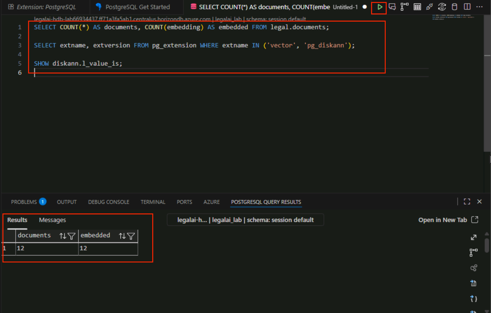

## Exercise 1: Build a realistic benchmark dataset

In this exercise, you create a table of 30,000 passages and a set of test queries with exact answers. These are the data and the ground truth for every later measurement.

### Task 1: Create a function that adds random variation to a vector

The function returns a copy of a vector with a small random change added to every value. You use it to generate passages and test queries.

1. In the legalai_lab query window, run the following statement.

   ```sql
   CREATE OR REPLACE FUNCTION legal.noisy_vec(base vector, noise double precision DEFAULT 0.04)
   RETURNS vector
   LANGUAGE sql VOLATILE
   AS $$
       SELECT ARRAY(
           SELECT (u.b + (random() - 0.5) * noise)::real
           FROM unnest(base::real[]) WITH ORDINALITY AS u(b, ord)
           ORDER BY u.ord
       )::vector
   $$;
   ```

   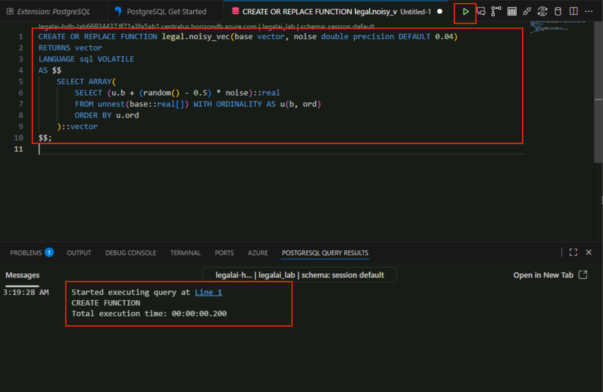

### Task 2: Generate 30,000 passages

Each document becomes 2,500 slightly different passages. Unlike copies of the same vector, these passages have different distances, so the index has real work to do.

1. Create the benchmark table, insert the passages, and update the table statistics by running the following statements.

   ```sql
   CREATE TABLE legal.bench_chunks (
       chunk_id  bigint GENERATED ALWAYS AS IDENTITY PRIMARY KEY,
       doc_id    text NOT NULL,
       doc_type  text NOT NULL,
       embedding vector(1536) NOT NULL
   );

   INSERT INTO legal.bench_chunks (doc_id, doc_type, embedding)
   SELECT d.doc_id, d.doc_type, legal.noisy_vec(d.embedding)
   FROM legal.documents AS d
   CROSS JOIN generate_series(1, 2500) AS n;

   ANALYZE legal.bench_chunks;
   ```

   Note: Wait for the insert to finish. It takes one to three minutes on 2 to 4 vCores

   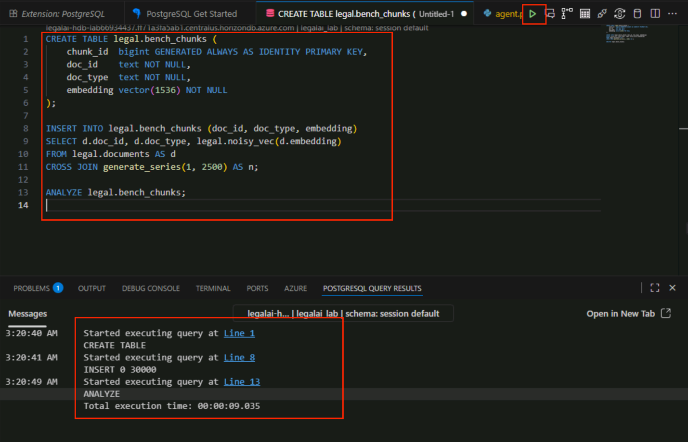

2. Count the passages and check the table size.

   ```sql
   SELECT COUNT(*) AS passages, pg_size_pretty(pg_table_size('legal.bench_chunks')) AS table_size
   FROM legal.bench_chunks;
   ```

   Verify that the result shows 30,000 passages and table size around 239MB.

   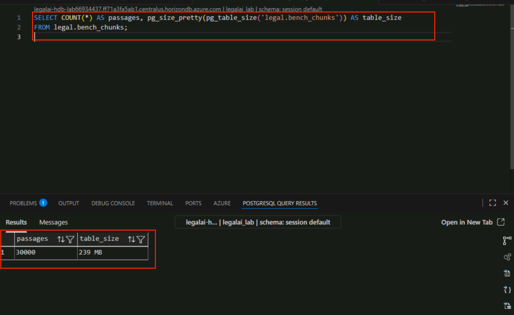

### Task 3: Create test queries and exact answers

You create 24 query vectors (two per document, with more variation than the stored passages) and record the exact top 10 for each. This is the ground truth for measuring recall. Do this before you create the index so the answers come from a full scan.

1. Run the following statements to create the test queries and the exact answers.

   ```sql
   CREATE TABLE legal.bench_queries AS
   SELECT ROW_NUMBER() OVER (ORDER BY d.doc_id, n) AS qid,
          legal.noisy_vec(d.embedding, 0.06) AS embedding
   FROM legal.documents AS d
   CROSS JOIN generate_series(1, 2) AS n;

   CREATE TABLE legal.bench_truth AS
   SELECT q.qid, t.chunk_id
   FROM legal.bench_queries AS q
   CROSS JOIN LATERAL (
       SELECT c.chunk_id
       FROM legal.bench_chunks AS c
       ORDER BY c.embedding <=> q.embedding
       LIMIT 10
   ) AS t;
   ```

   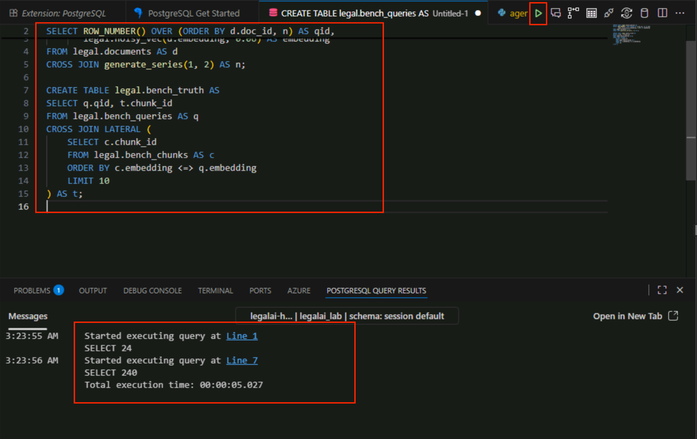

2. Check the row counts.

   ```sql
   SELECT COUNT(*) AS queries FROM legal.bench_queries;
   SELECT COUNT(*) AS truth_rows FROM legal.bench_truth;
   ```

   Verify that you have 24 queries and 240 truth rows.

   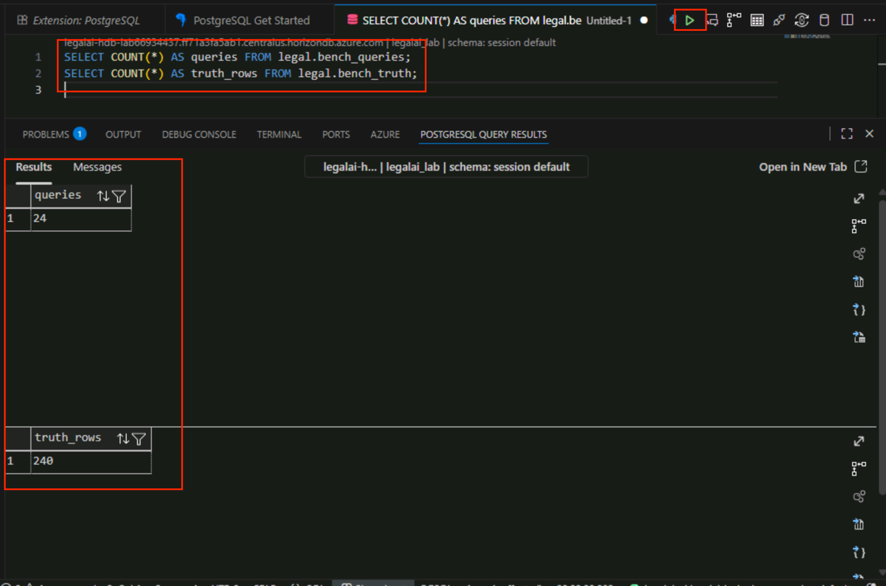

    Verify that you have 24 queries and 240 truth rows.

## Exercise 2: Baseline, DiskANN index and query plan

In this exercise, you measure exact search without an index, build a DiskANN index, and compare the query plans and sizes.

### Task 1: Measure the baseline without an index

The baseline shows how an exact search runs today. You record three values from the plan to compare later.

1. Run the following query.

   ```sql
   EXPLAIN (ANALYZE, BUFFERS)
   SELECT chunk_id, doc_id
   FROM legal.bench_chunks
   ORDER BY embedding <=> (SELECT embedding FROM legal.bench_queries WHERE qid = 1)
   LIMIT 10;
   ```

   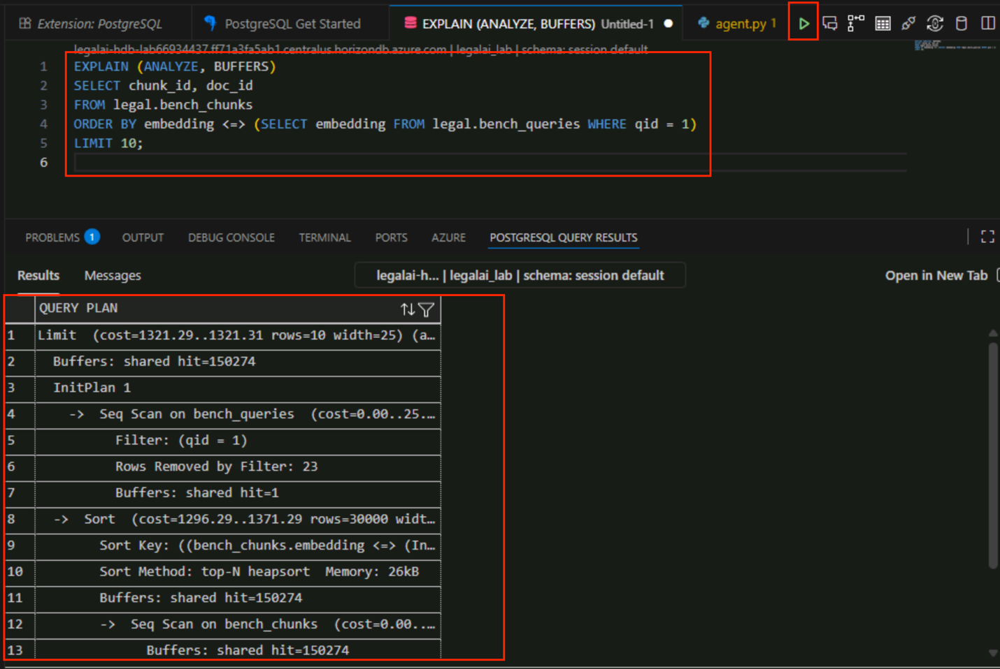

### Task 2: Create the DiskANN index

You build the index with the default graph settings. The two options control the index graph.

1. Run the following statements. The index build takes one to four minutes.

   ```sql
   CREATE INDEX idx_bench_diskann
   ON legal.bench_chunks
   USING diskann (embedding vector_cosine_ops)
   WITH (max_neighbors = 32, l_value_ib = 100);

   ANALYZE legal.bench_chunks;
   ```

2. While the index builds, review the build options.

   | Option | Meaning | Effect of a higher value |
   |---|---|---|
   | max_neighbors | Maximum edges per node (default 32) | Can improve recall, uses more space |
   | l_value_ib | Search list size while building (default 100) | Better index quality, slower build |

   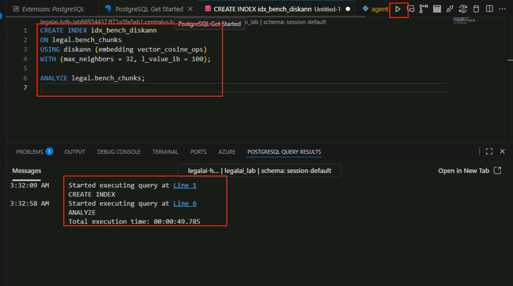

### Task 3: Compare the plan

You run the same query again to see whether the planner now uses the index.

1. Run the same EXPLAIN ANALYZE query again.

   ```sql
   EXPLAIN (ANALYZE, BUFFERS)
   SELECT chunk_id, doc_id
   FROM legal.bench_chunks
   ORDER BY embedding <=> (SELECT embedding FROM legal.bench_queries WHERE qid = 1)
   LIMIT 10;
   ```

   Check the scan type. The plan may use an Index Scan with idx_bench_diskann when the planner estimates that it is beneficial. On a 30,000-row table, the planner may still choose a sequential scan, and the indexed query is not guaranteed to be faster.

   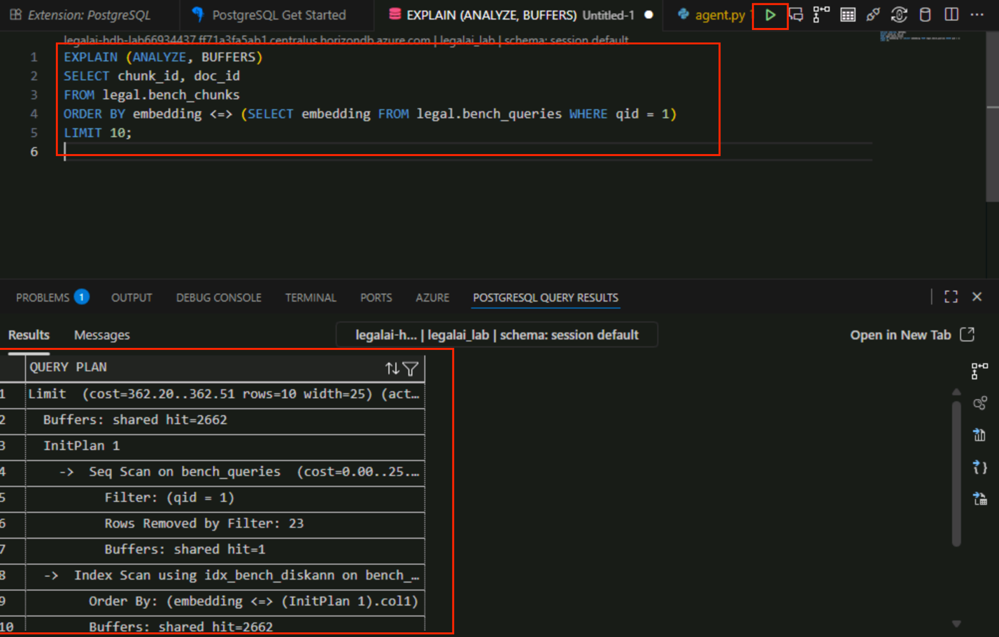

2. If you still see a Seq Scan, the planner decided it was cheaper. Check that ANALYZE ran, then test the index explicitly inside a transaction.

   ```sql
   BEGIN;
   SET LOCAL enable_seqscan = off;
   EXPLAIN (ANALYZE, BUFFERS)
   SELECT chunk_id, doc_id
   FROM legal.bench_chunks
   ORDER BY embedding <=> (SELECT embedding FROM legal.bench_queries WHERE qid = 1)
   LIMIT 10;
   COMMIT;
   ```

   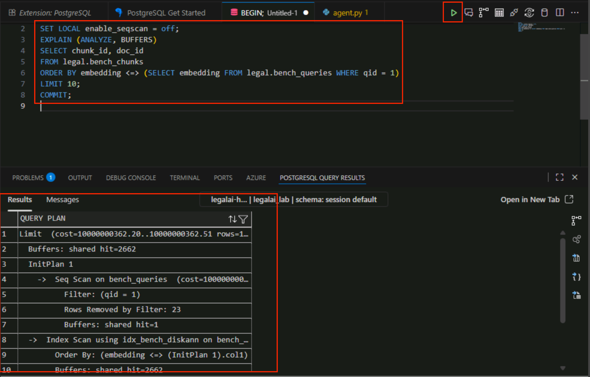

### Task 4: Check the size cost

An index uses additional storage. You compare the table size with the index size.

1. Run the following query.

   ```sql
   SELECT pg_size_pretty(pg_table_size('legal.bench_chunks')) AS table_size,
          pg_size_pretty(pg_relation_size('legal.idx_bench_diskann')) AS index_size;
   ```

   Record both sizes. An index is a trade-off: it consumes additional storage and adds write/build overhead. Query speed is workload-dependent; measure it rather than assuming the index is always faster.

   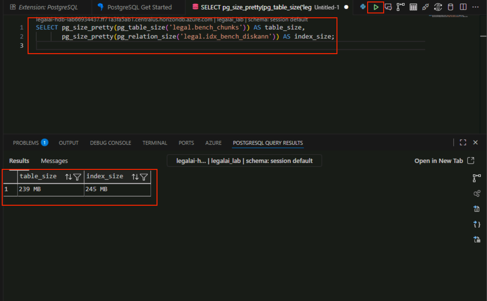


## Exercise 3: Tune the recall and latency trade-off

An approximate index may miss some true neighbors. Recall is the share of the exact top 10 that the index also returns. At query time, diskann.l_value_is sets how many candidates the search keeps: a larger value gives higher recall and slower queries. In this exercise, you measure both for several values and choose a setting.

### Task 1: Create bench.py

The script runs the tuning sweep and the load test. You create it once and use it in this exercise and in Exercise 4.

1. Select File->New file->Python File.

   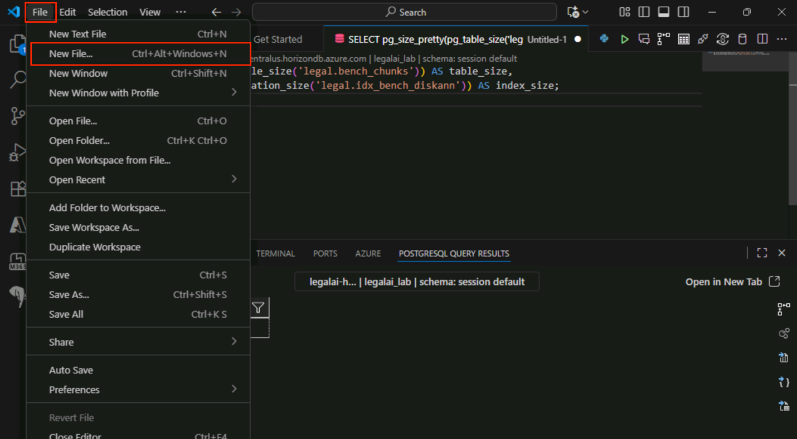

   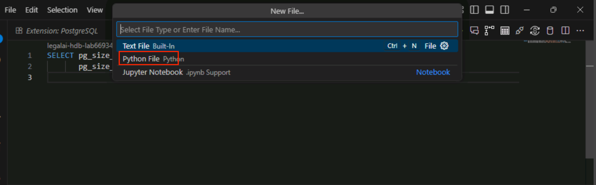

2. Create a file named bench.py with the following content.

   ```python
   import argparse
   import concurrent.futures as cf
   import os
   import statistics
   import time

   import psycopg

   DSN = os.environ['HORIZONDB_DSN']
   ANN_SQL = '''SELECT chunk_id FROM legal.bench_chunks
   ORDER BY embedding <=> %s::vector LIMIT 10'''


   def load_queries(conn):
       rows = conn.execute('SELECT qid, embedding::text FROM legal.bench_queries ORDER BY qid').fetchall()
       return [(r[0], r[1]) for r in rows]


   def load_truth(conn):
       truth = {}
       for qid, chunk_id in conn.execute('SELECT qid, chunk_id FROM legal.bench_truth').fetchall():
           truth.setdefault(qid, set()).add(chunk_id)
       return truth


   def tune(l_values):
       with psycopg.connect(DSN, autocommit=True) as conn:
           queries = load_queries(conn)
           truth = load_truth(conn)
           print('l_value_is | recall@10 | avg ms | p95 ms')
           for l_value in l_values:
               conn.execute(f'SET diskann.l_value_is = {int(l_value)}')
               hits, total, times = 0, 0, []
               for qid, emb in queries:
                   start = time.perf_counter()
                   ids = {r[0] for r in conn.execute(ANN_SQL, (emb,)).fetchall()}
                   times.append((time.perf_counter() - start) * 1000)
                   hits += len(ids & truth[qid])
                   total += len(truth[qid])
               times.sort()
               p95 = times[max(0, int(len(times) * 0.95) - 1)]
               print(f'{l_value:>10} | {100 * hits / total:>8.1f}% | {statistics.mean(times):>6.1f} | {p95:>6.1f}')


   def worker(mode, l_value, queries, offset, stop_at):
       latencies = []
       with psycopg.connect(DSN, autocommit=True) as conn:
           if mode == 'exact':
               conn.execute('SET enable_indexscan = off')
           else:
               conn.execute(f'SET diskann.l_value_is = {int(l_value)}')
           i = offset
           while time.time() < stop_at:
               emb = queries[i % len(queries)][1]
               start = time.perf_counter()
               conn.execute(ANN_SQL, (emb,)).fetchall()
               latencies.append((time.perf_counter() - start) * 1000)
               i += 1
       return latencies


   def load(mode, l_value, thread_counts, seconds):
       with psycopg.connect(DSN, autocommit=True) as conn:
           queries = load_queries(conn)
       print(f'mode={mode} l_value_is={l_value}')
       print('threads |   QPS | p50 ms | p95 ms')
       for threads in thread_counts:
           stop_at = time.time() + seconds
           with cf.ThreadPoolExecutor(max_workers=threads) as pool:
               futures = [pool.submit(worker, mode, l_value, queries, n * 3, stop_at) for n in range(threads)]
               latencies = sorted(x for f in futures for x in f.result())
           qps = len(latencies) / seconds
           p50 = latencies[len(latencies) // 2]
           p95 = latencies[max(0, int(len(latencies) * 0.95) - 1)]
           print(f'{threads:>7} | {qps:>5.1f} | {p50:>6.1f} | {p95:>6.1f}')


   if __name__ == '__main__':
       parser = argparse.ArgumentParser()
       sub = parser.add_subparsers(dest='cmd', required=True)
       tune_parser = sub.add_parser('tune')
       tune_parser.add_argument('--l', type=int, nargs='+', default=[10, 20, 50, 100, 200, 400])
       load_parser = sub.add_parser('load')
       load_parser.add_argument('--mode', choices=['ann', 'exact'], default='ann')
       load_parser.add_argument('--l-value', type=int, default=100)
       load_parser.add_argument('--threads', type=int, nargs='+', default=[1, 4, 8])
       load_parser.add_argument('--seconds', type=int, default=8)
       args = parser.parse_args()
       if args.cmd == 'tune':
           tune(args.l)
       else:
           load(args.mode, args.l_value, args.threads, args.seconds)
   ```

   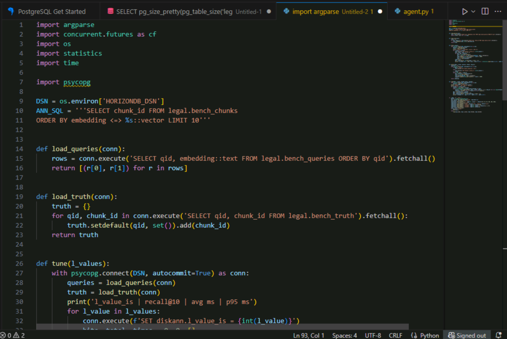

3. Save the file with name:+++bench.py+++. These file should be save in the same folder where you keep the agent from Lab 4-: C:\\Lab Files,

   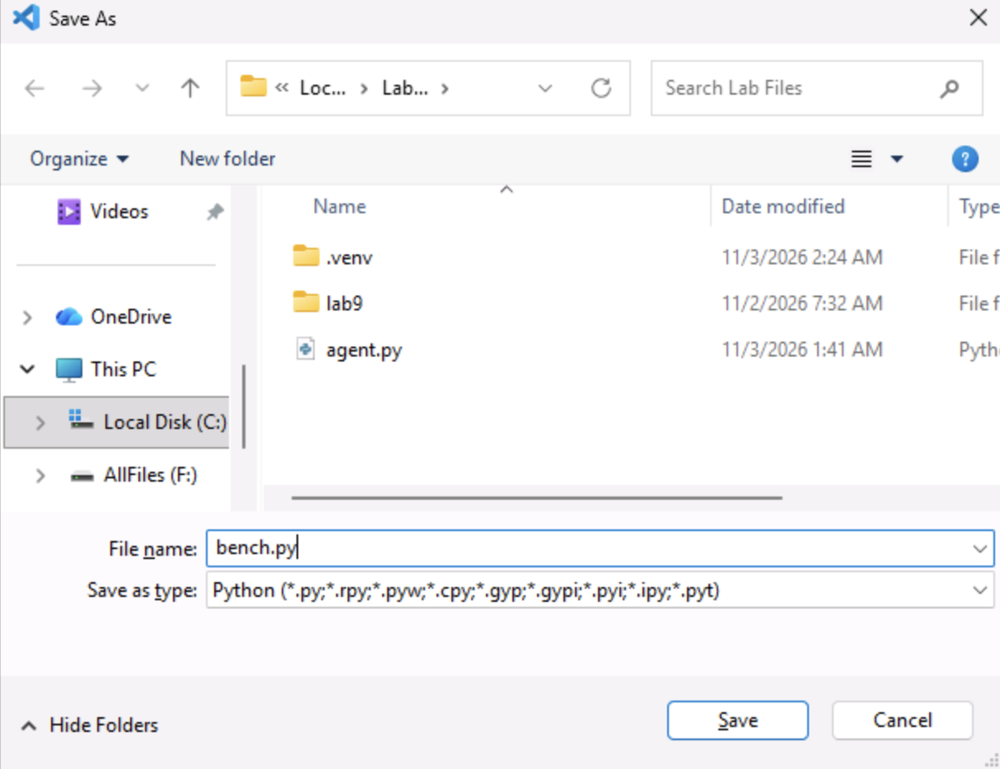

4. Select three dots(…)->Terminal->New terminal and run the following command to activate with the virtual environment:

   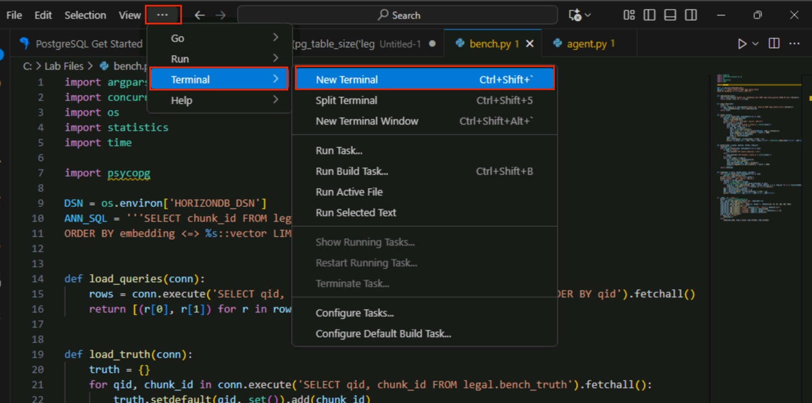

   ```powershell
   cd “C:\Lab Files”
   .\.venv\Scripts\Activate.ps1
   $env:HORIZONDB_DSN = 'host=<CLUSTER_ENDPOINT> port=5432 dbname=legalai_lab user=lawadmin password=Pass@1234 sslmode=require'
   ```

   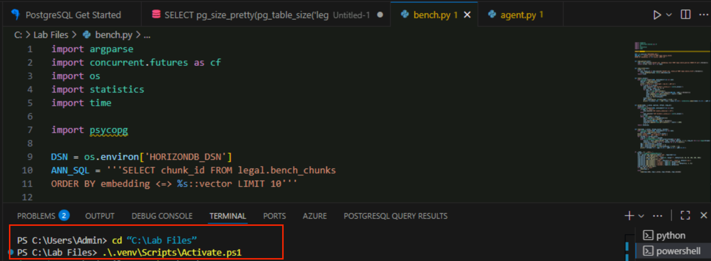

   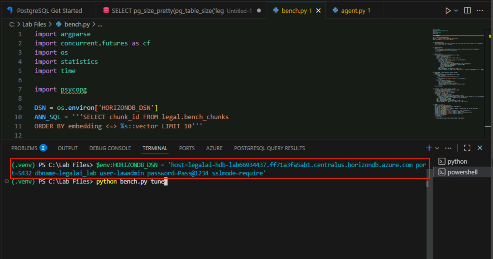

### Task 2: Run the tuning sweep

The script runs the 24 test queries at each l_value_is setting and compares the results with the exact answers you stored in legal.bench_truth.

1. Run the following command.

   ```powershell
   python bench.py tune
   ```

   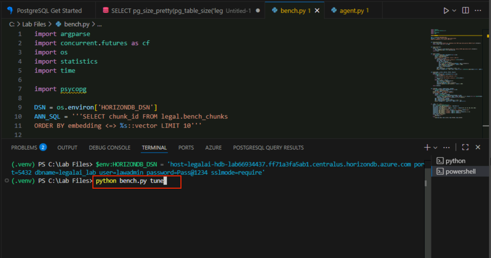

   Expected pattern: larger l_value_is values generally allow a broader candidate search and may improve recall, often at the cost of additional query time. The relationship is workload- and plan-dependent; the values may not change monotonically, and this synthetic dataset may produce 100% recall at every setting. Record what you observe.

   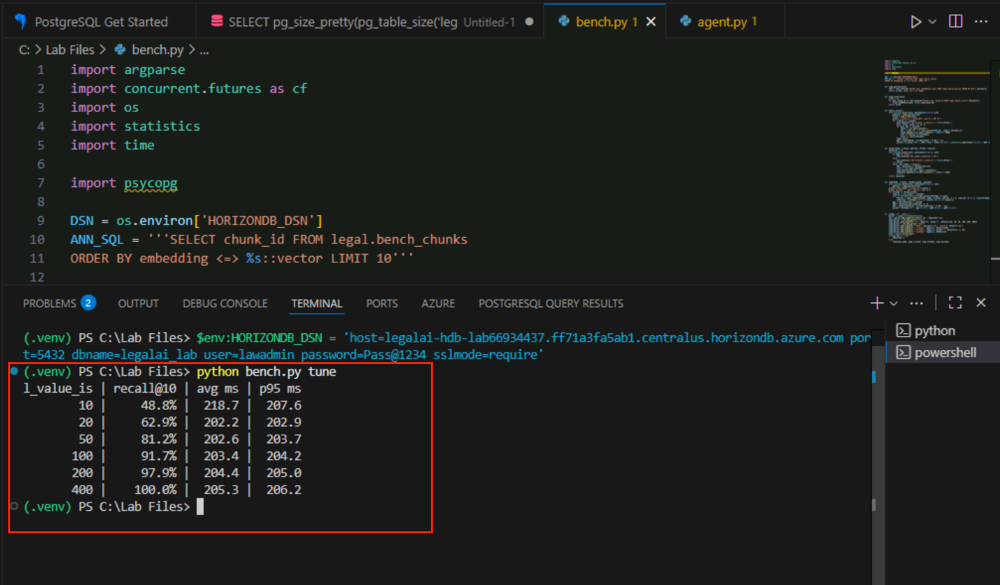

### Task 4: Change the index build settings

You build a second index with a larger graph and repeat the sweep. Drop the old index first so the planner uses the new one.

1. Run the following query in the editor.

   ```sql
   DROP INDEX legal.idx_bench_diskann;

   CREATE INDEX idx_bench_diskann
   ON legal.bench_chunks
   USING diskann (embedding vector_cosine_ops)
   WITH (max_neighbors = 64, l_value_ib = 200);
   ```

   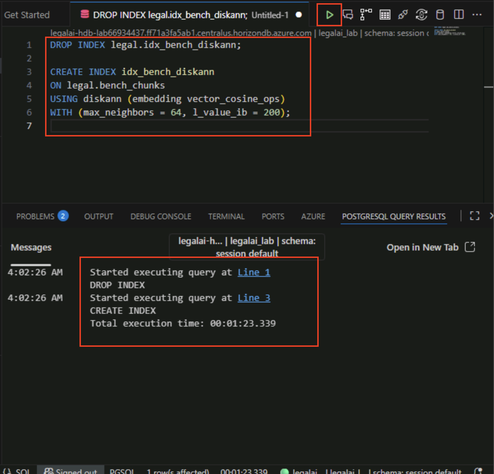

2. Open Terminal and run +++python bench.py tune+++ again.

   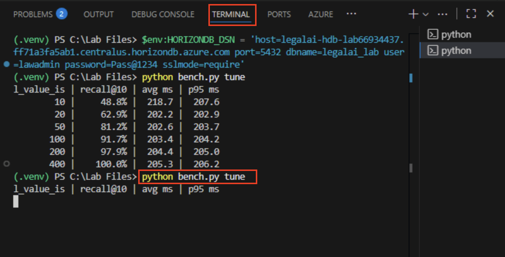

3. Compare recall, latency and size with the first index.

   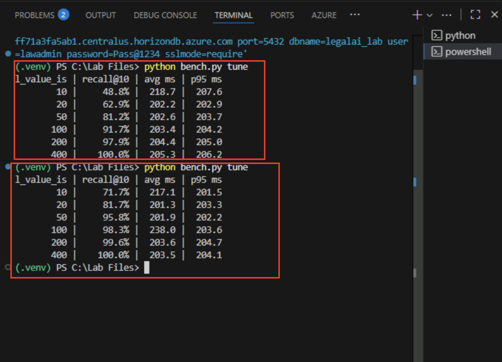


## Exercise 4: Load test and filtered search

In this exercise, you compare exact and indexed search with several simultaneous clients, and then run a vector query that includes a metadata filter.

### Task 1: Exact search under concurrent load

This run disables the index and measures exact search with 1 and 4 simultaneous clients, each running for 8 seconds.

1. In the terminal, run the following command.

   ```powershell
   python bench.py load --mode exact --threads 1 4
   ```

   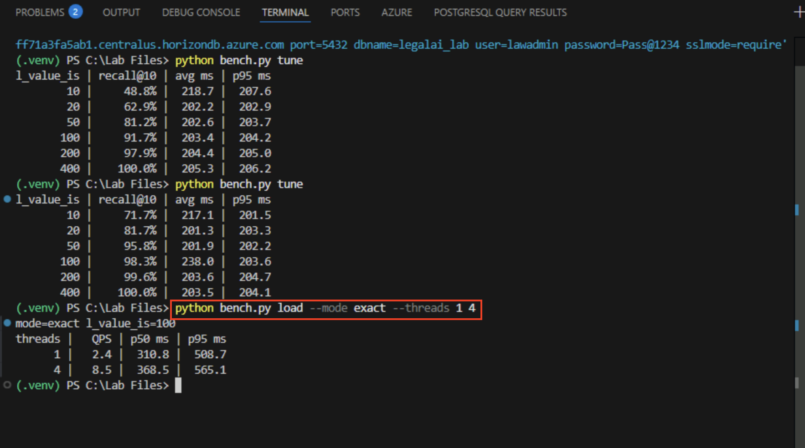

2. Review the results for each client count. Compare the QPS(queries per second) and p95 latency for 1 and 4 simultaneous clients to see how increasing concurrent requests affects exact-search throughput and response time.

   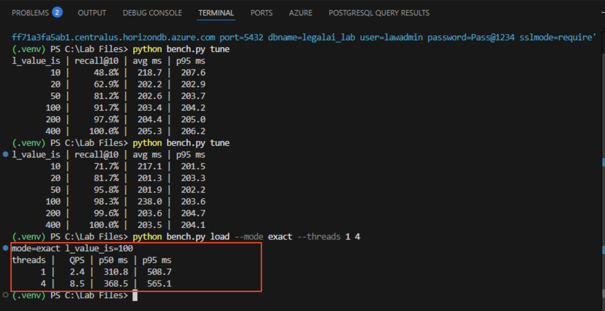

### Task 2: Indexed search under concurrent load

You repeat the test with the index, using the l_value_is you chose in Exercise 3.

1. Run the following command.

   ```powershell
   python bench.py load --mode ann --l-value 100 --threads 1 4 8
   ```

   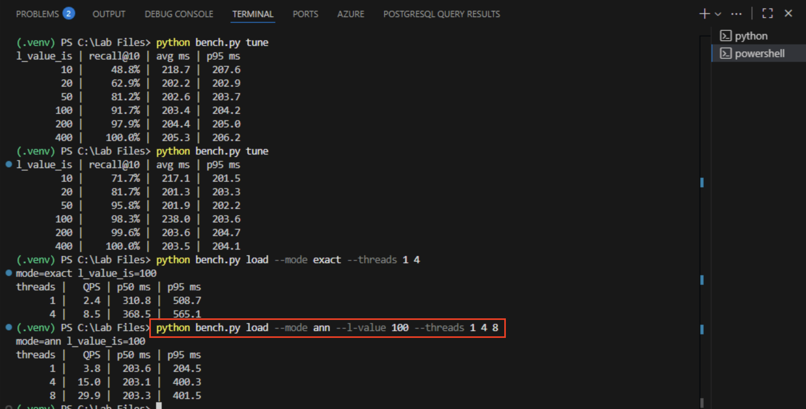

2. Compare QPS and p95 latency for each mode and concurrency level. Indexed search may improve throughput, but the size of the improvement depends on the compute tier, cache state, planner choice, and workload. Do not treat a particular speed-up as guaranteed.

   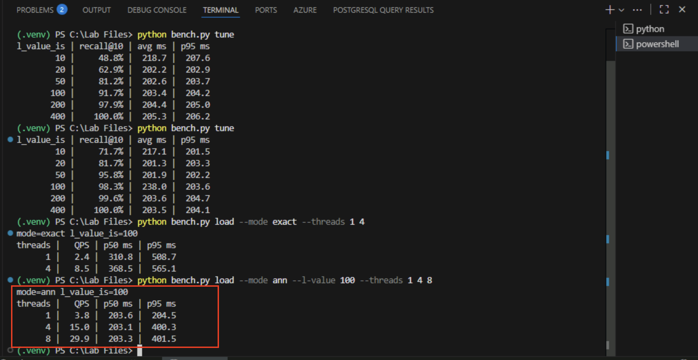

### Task 3: Filtered vector search with DiskANN

Real applications combine vector similarity with metadata filters such as document type, jurisdiction, or matter status. Azure HorizonDB DiskANN supports advanced filtering so supported predicates can participate in the index search. Do not assume that every filtered query behaves like a simple post-filter over a fixed candidate batch.

1. Navigate back to SQL editor and inspect the filtering settings available in your HorizonDB preview build.

   ```sql
   SHOW diskann.enable_filter_hook;
   SHOW diskann.selectivity_min;
   SHOW diskann.selectivity_threshold;
   SHOW diskann.filtering_beta;
   SHOW diskann.l_value_is;
   ```

   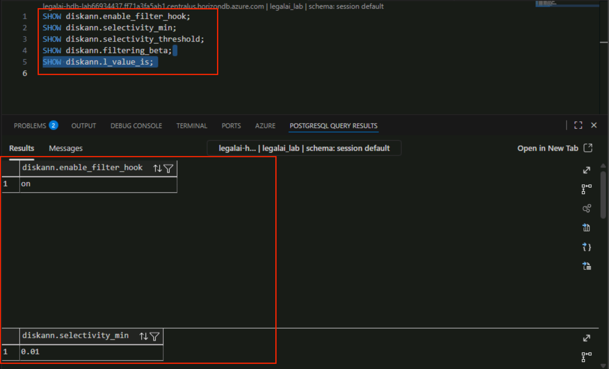

   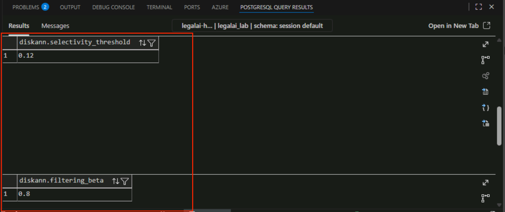

   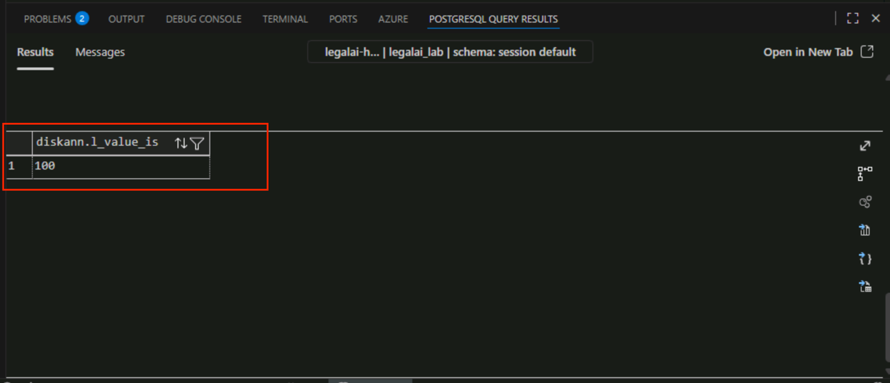

2. If these settings are available, enable and configure the filtering hook for this test.

   ```sql
   SET diskann.enable_filter_hook = true;
   SET diskann.selectivity_min = '0.0';
   SET diskann.selectivity_threshold = '1.0';
   SET diskann.filtering_beta = 0.85;
   SET diskann.l_value_is = 100;
   ```

   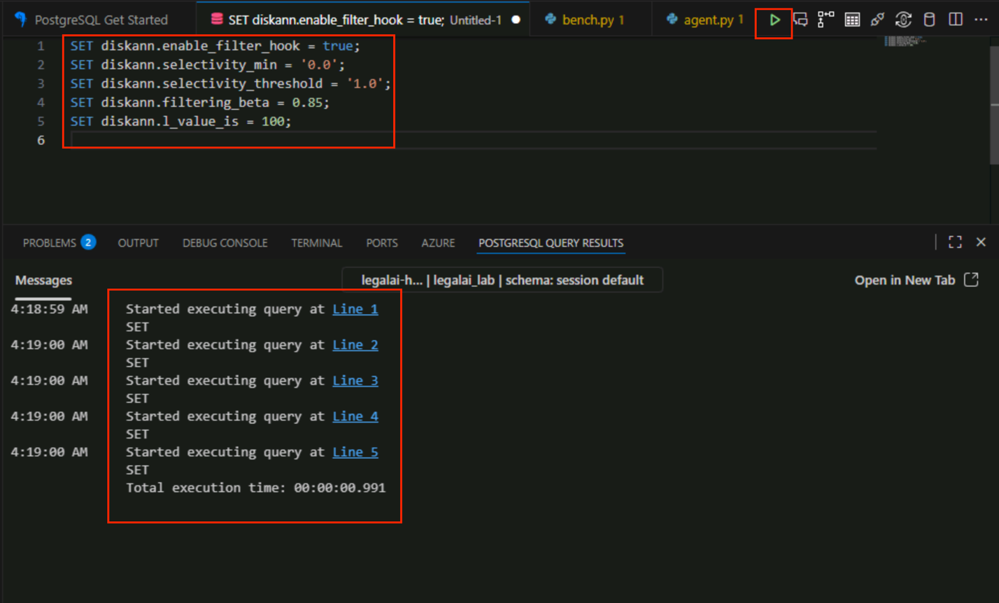

3. Run a filtered nearest-neighbor query for firm memos. Query 1 is associated with a court opinion, so the metadata predicate asks DiskANN to find nearby passages that belong to documents of type MEMO.

   ```sql
   EXPLAIN (ANALYZE, BUFFERS)
   SELECT chunk_id, doc_id
   FROM legal.bench_chunks
   WHERE doc_type = 'MEMO'
   ORDER BY embedding <=> (
       SELECT embedding
       FROM legal.bench_queries
       WHERE qid = 1
   )
   LIMIT 50;
   ```

   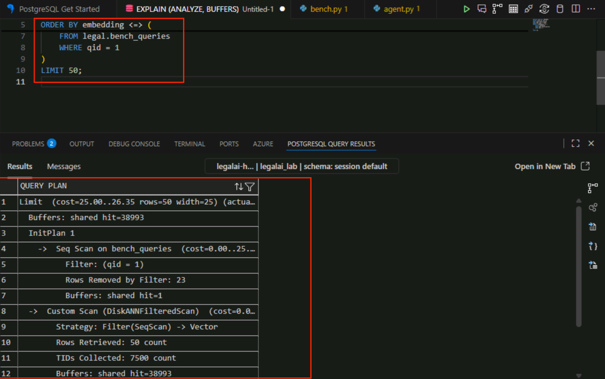

4. Record the number of rows returned and the execution time.

   ```sql
   SELECT COUNT(*) AS rows_returned
   FROM (
       SELECT chunk_id
       FROM legal.bench_chunks
       WHERE doc_type = 'MEMO'
       ORDER BY embedding <=> (
           SELECT embedding
           FROM legal.bench_queries
           WHERE qid = 1
       )
       LIMIT 50
   ) AS filtered_results;
   ```

   Expected result: the query returns up to 50 matching memo passages when enough qualifying rows are available. The actual plan, row count, and latency depend on the installed preview build and its filtering configuration. The key validation is that the metadata predicate is applied and that the returned rows satisfy doc_type = 'MEMO'.

   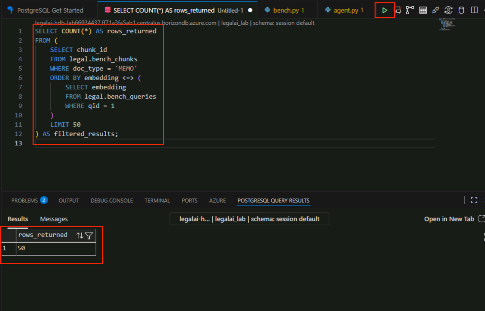

### Task 4: Reset the session settings

You return the session settings to their defaults so they do not affect later work.

1. Run the following statements.

   ```sql
   RESET diskann.l_value_is;
   RESET diskann.enable_filter_hook;
   RESET diskann.selectivity_min;
   RESET diskann.selectivity_threshold;
   RESET diskann.filtering_beta;
   ```

   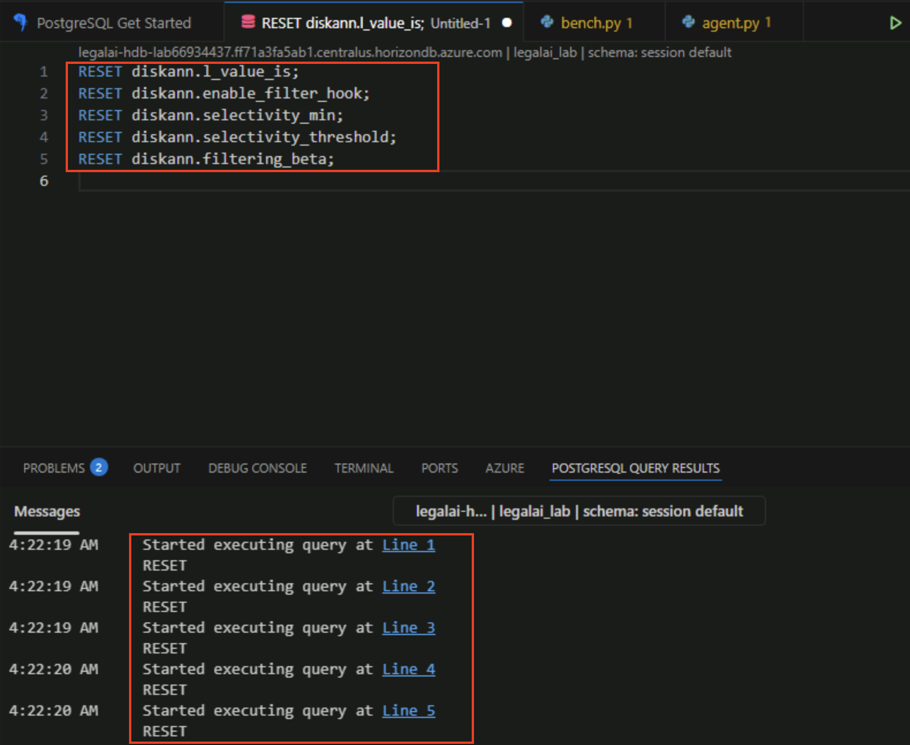

**Checkpoint:** You compared exact and indexed search under load, and you saw how a filter can starve an approximate search.

## Summary

In this lab, you prepared a synthetic benchmark of 30,000 passages with 24 test queries and exact top-10 answers, then compared exact search with a DiskANN index. You read EXPLAIN ANALYZE plans to see whether the planner chose a sequential scan or an index scan, and you checked the storage cost of the index. You measured recall and latency at several diskann.l_value_is settings, rebuilt the index with a larger graph (max_neighbors = 64, l_value_ib = 200), and compared the results. You then ran concurrent load tests for exact and indexed search, and ran a filtered vector query that combines similarity with a metadata predicate using DiskANN filtering. Finally, you reset the session settings. The key takeaway is to measure rather than assume: the benefit of an index depends on the planner's choice, the compute tier, the cache state and the workload, and the synthetic data in this lab means the results are for learning and do not predict production performance.
